# Headroom

*Headroom* (inglês: folga, espaço de sobra) devolve ao PC o espaço e o fôlego que ele perdeu.
É um analisador de espaço em disco com limpeza segura, diagnóstico de saúde do PC, reparos do Windows e
otimização, feito em C# .NET 8 + WPF (MVVM), com interface toda em português do Brasil.

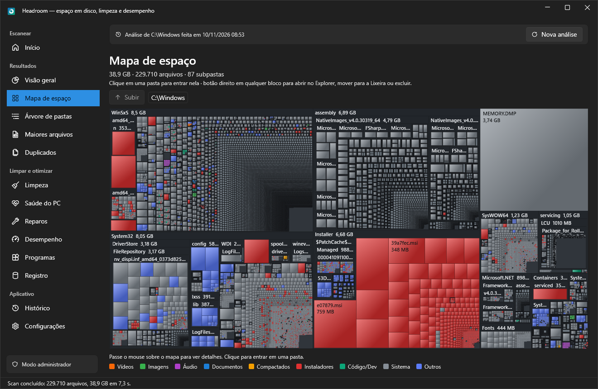

## Download

Baixe a versão mais recente em **[Releases](https://github.com/MaikeSouzaL/headroom/releases/latest)**:

- **Headroom-Setup-x.y.z.exe**: instalador (Menu Iniciar, Área de Trabalho opcional e desinstalação pelo Windows).
- **Headroom.exe**: versão portátil, um único arquivo que é só abrir.

Nenhum dos dois precisa do .NET instalado. Como os arquivos ainda não têm assinatura digital, o Windows pode
mostrar "O Windows protegeu o computador": clique em **Mais informações → Executar assim mesmo**.

## O que ele faz

| Área | Recursos |
|---|---|
| **Escanear** | Marque um, vários ou todos os discos (letra, nome, tipo SSD/HD/USB/rede, total/usado/livre, barra vermelha acima de 90%) ou escolha uma pasta. Vários discos são escaneados um após o outro e a barra "Disco analisado" alterna entre os resultados. Scanner paralelo com progresso (arquivos, GB, pasta atual, velocidade) e cancelamento. Não segue junctions/links e ignora arquivos que estão só na nuvem (OneDrive). |
| **Análises salvas** | Cada análise é guardada (compactada) e reaberta sem escanear: ao abrir o app, a última análise volta sozinha; no Início, "Abrir análise salva" ou "Nova análise". Exclusões feitas pelo app atualizam o arquivo salvo. Nas telas de resultado, a barra mostra a data da análise e "Nova análise" escaneia de novo só o disco exibido. E:\ (790 mil arquivos): scan de 17 s, reabertura em ~5 s com o app abrindo, arquivo de 8,8 MB. |
| **Visão geral** | Rosca por categoria, barras das 15 maiores pastas, cards (total, livre, arquivos, recuperável estimado), tempo do scan e explicação da diferença em relação ao "usado" do disco. Exporta HTML e CSV. |
| **Mapa de espaço** | Treemap *squarified* feito à mão num `Canvas`, cores por categoria, clique entra na pasta, breadcrumb e menu de contexto (abrir, copiar caminho, Lixeira, excluir). |
| **Árvore de pastas** | Lista em árvore virtualizada com colunas Nome · Tamanho · % da pasta-pai · Arquivos · Modificado; filhos carregados sob demanda. Caixa de marcação em cada arquivo/pasta e barra "Mover para a Lixeira / Excluir permanentemente". |
| **Maiores arquivos** | Os N maiores (min-heap, padrão 500) com busca, categoria, tamanho mínimo e "não modificado há X meses". Marque os que quer apagar (caixa, Espaço ou "Marcar todos") e use a barra de ações; só o que está visível no filtro é apagado. |
| **Duplicados** | Tamanho → início (64 KB, xxHash64) → fim (64 KB) → hash completo (xxHash128); descarta hardlinks. Cada cópia tem caixa "excluir" (já vem marcado: todas menos a mais antiga); o app recusa apagar todas as cópias de um grupo. |
| **Limpeza** | 182 regras (111 se aplicavam no PC de teste): Sistema, Navegadores (todos os perfis), Aplicativos, Jogos, Desenvolvedor, Arquivos do usuário, Privacidade e Avançado. Perfis Rápida/Completa/Dev/Gamer/Personalizada, prévia obrigatória, Lixeira por padrão, log e resumo. Regras extras em JSON. |
| **Saúde do PC** | Diagnóstico somente leitura com nota 0–100: espaço, SMART/desgaste/temperatura, TRIM, erros NTFS, memória, CPU, inicialização, reinício pendente, Windows Update, drivers com erro, telas azuis/erros críticos (7 dias), antivírus, firewall, UAC, plano de energia, bateria, rede e pontos de restauração. |
| **Reparos** | SFC, DISM CheckHealth/ScanHealth/RestoreHealth, CHKDSK online e agendado, otimizar unidades (TRIM/desfragmentação), redefinir Windows Update, cache da Store, DNS, renovar IP, redefinir Winsock/TCP-IP, destravar fila de impressão, reconstruir cache de ícones e índice de pesquisa, sincronizar relógio, teste de memória e relatórios de bateria/energia/confiabilidade. |
| **Desempenho** | **Monitor** ao vivo (CPU e RAM dos últimos 60 s, standby/cache, memória comprometida, processos/threads/handles) com recomendações do que fazer agora. **Liberar memória** honesto: reduz a memória dos programas em segundo plano (menos o que você está usando) e, como administrador, esvazia o cache em espera e o cache de arquivos — com o aviso de que só ajuda quando a RAM está quase cheia. **Processos**: CPU (média dos últimos segundos), memória, disco/s e prioridade de cada um; aponta os que estão pesando ou "Não respondendo"; finalizar (com confirmação), baixar prioridade ou abrir o local; processos do Windows protegidos. **Inicialização** reversível (registro, pasta Inicializar e tarefas no logon). **Ajustes** reversíveis com backup dos valores anteriores: transparência, animações, atraso de menus, atraso da inicialização, apps da Store em segundo plano, gravação do Game Bar, Modo de Jogo, sugestões/apps promovidos e pesquisa na web do Iniciar. **Energia**: plano de energia. |
| **Programas** | Instalados (registro HKLM/HKCU 32/64 bits) com tamanho real, data de instalação e último uso estimado. **Desinstalação completa**: abre o desinstalador oficial, espera ele terminar (inclusive os que se copiam para a pasta temporária) e procura o que sobrou: pasta de instalação, pastas em Arquivos de Programas/ProgramData/AppData/Menu Iniciar, atalhos, chaves do registro (Software, App Paths, "Abrir com"), itens de inicialização, entrada de desinstalação órfã, tarefas agendadas e serviços. Itens identificados com segurança vêm marcados; nomes só parecidos vêm como "Revisar". Nada que outro programa instalado use é sugerido. Remoção: arquivos para a Lixeira, registro com backup `.reg` (desfazer na tela Registro), cópia do XML das tarefas e da chave dos serviços. Se o desinstalador sumiu, oferece remover só os rastros. Também: apps da Store e bloatware; recursos opcionais e idiomas não usados; restos antigos de programas (com o motivo). |
| **Registro** | Desativado por padrão. Só itens comprovadamente órfãos, backup `.reg` obrigatório e "Desfazer". |
| **Histórico** | Evolução do espaço livre (gráfico de linha), scans e limpezas anteriores. |
| **Extras** | Tema claro/escuro seguindo o Windows, limpeza agendada (Agendador de Tarefas) com notificação, alerta de pouco espaço, linha de comando, instalador Inno Setup. |

### Telas

| Início | Visão geral |
|---|---|
| 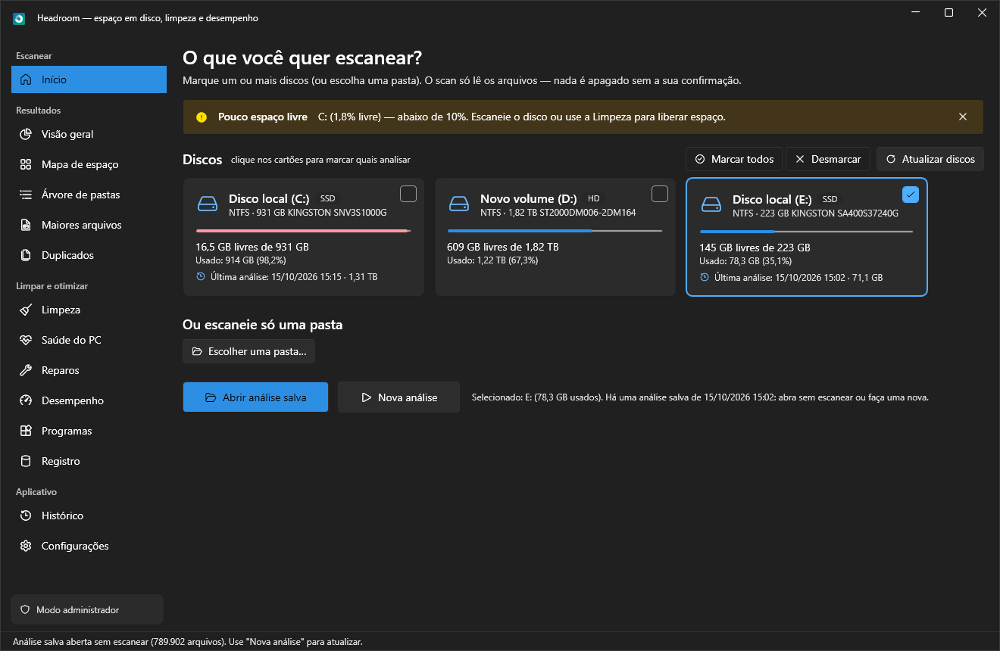 | 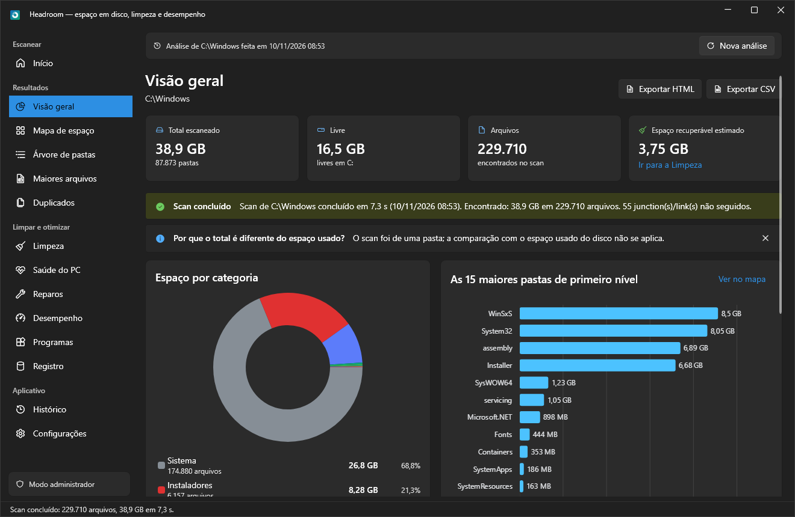 |
| **Árvore de pastas** | **Maiores arquivos** |
| 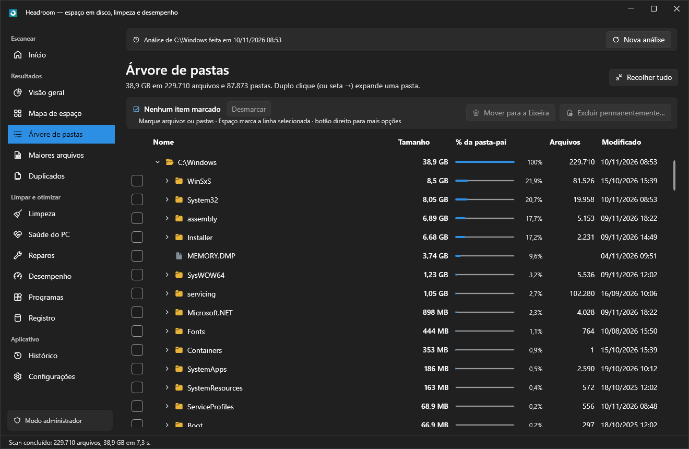 | 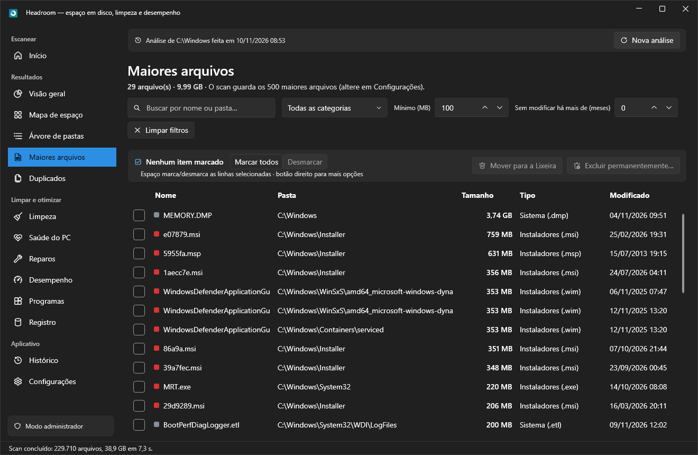 |
| **Mapa de espaço** | **Desinstalação completa** |
|  | 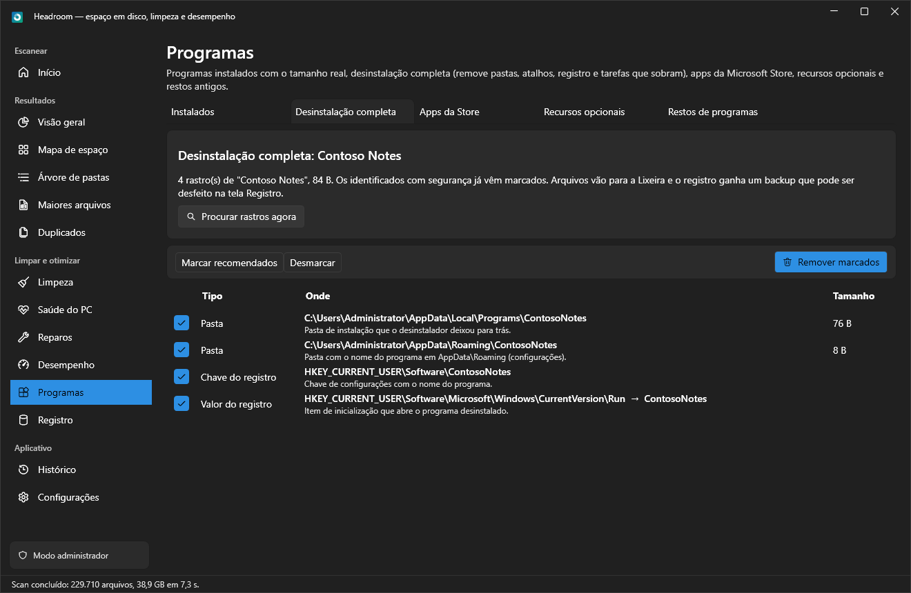 |
| **Limpeza** | **Escaneando** |
| 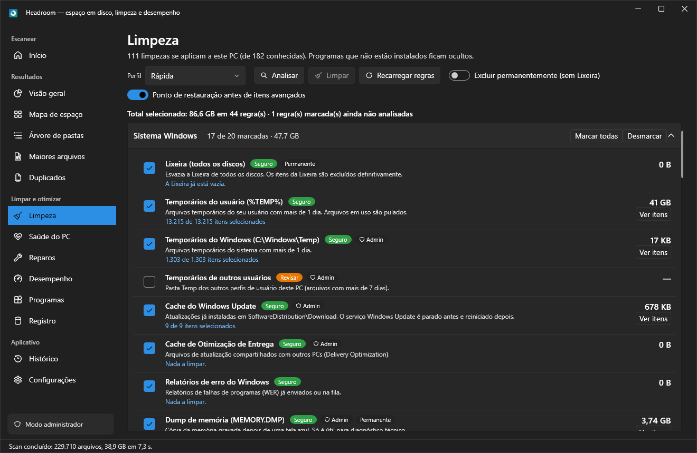 | 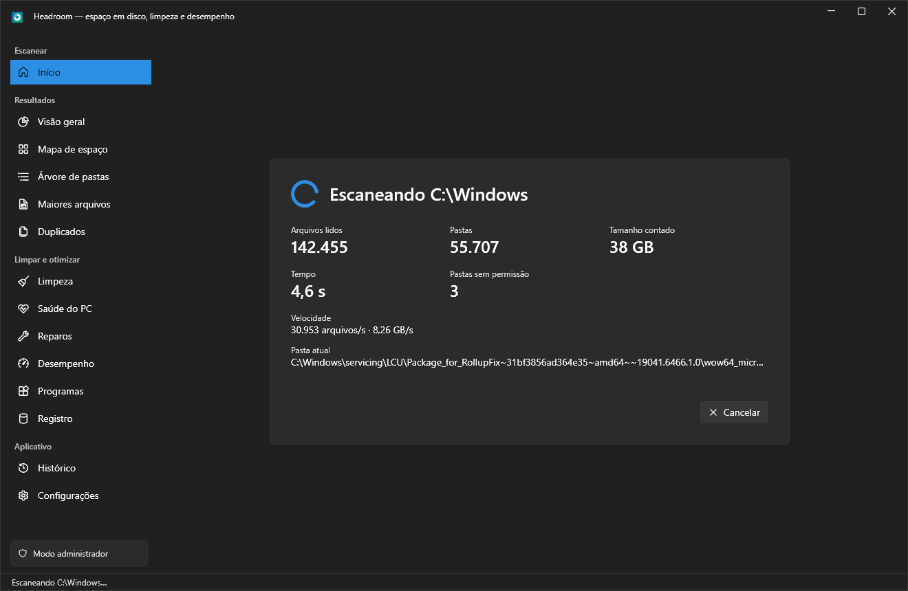 |
| **Saúde do PC** | **Reparos** |
| 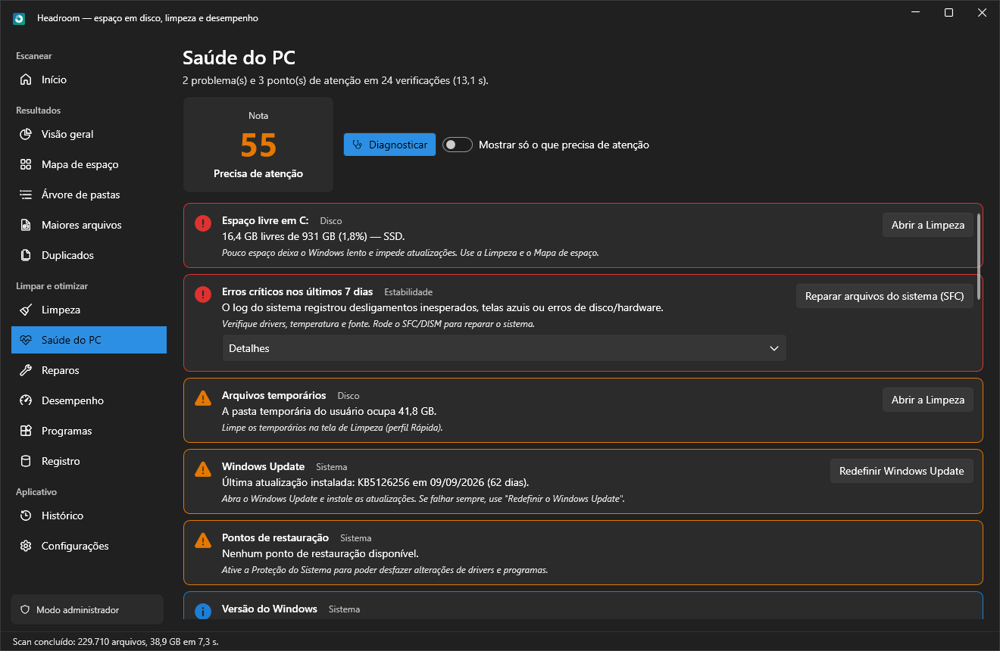 | 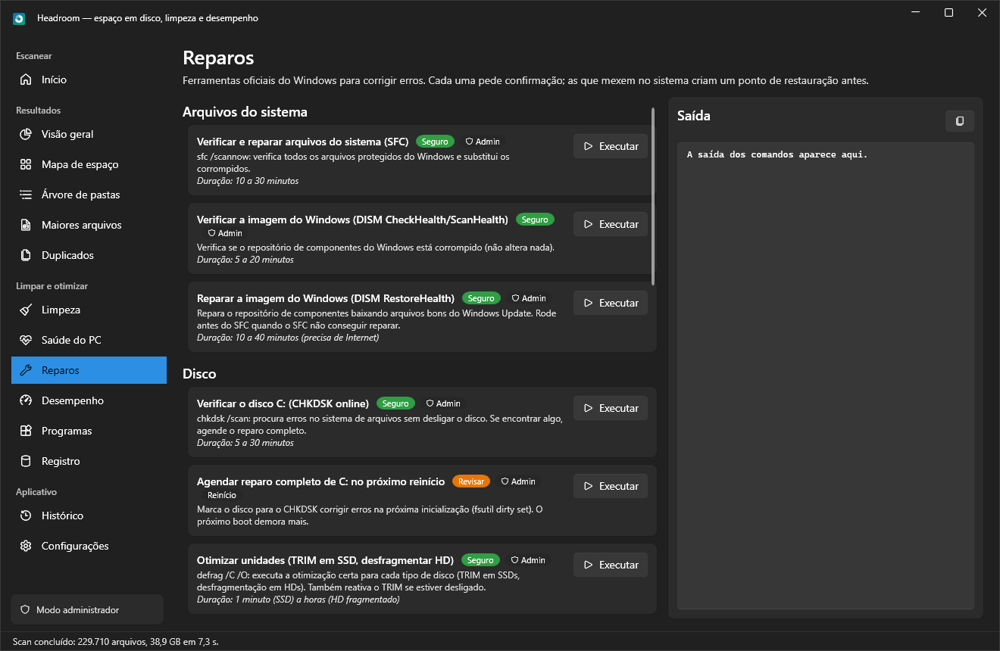 |
| **Desempenho — Monitor** | **Desempenho — Processos** |
| 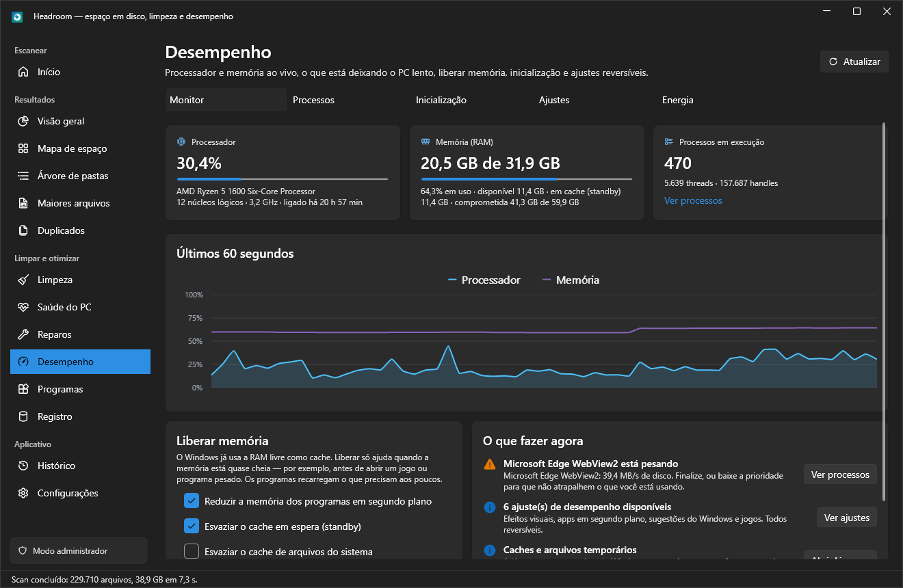 | 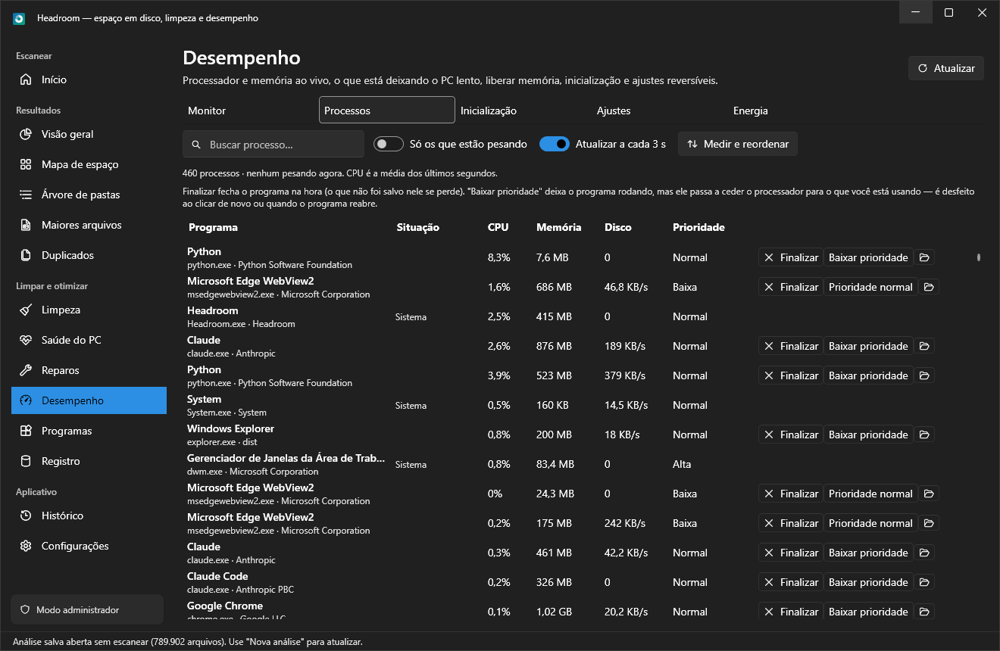 |
| **Desempenho — Ajustes** | **Duplicados** |
| 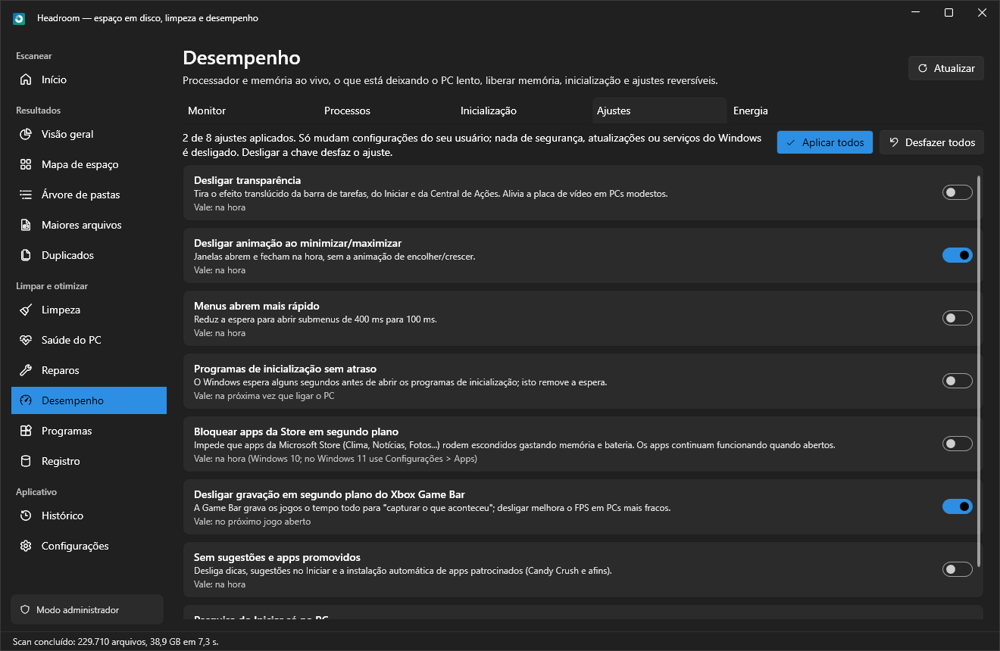 | 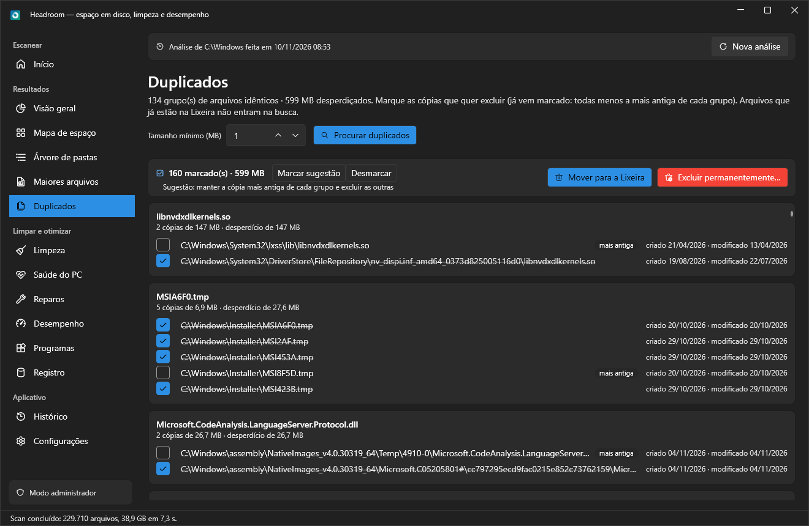 |

## Requisitos

- Windows 10 (1809+) ou 11, x64
- Para compilar: [.NET 8 SDK](https://dotnet.microsoft.com/download/dotnet/8.0) (o `global.json` aceita 8.0.4xx)
- Opcional: [Inno Setup 6](https://jrsoftware.org/isdl.php) para gerar o instalador

## Como compilar, rodar e testar

```powershell
dotnet build Headroom.sln -c Release
dotnet run --project src\Headroom.App -c Release
dotnet test tests\Headroom.Tests
```

O app roda como `asInvoker`. Sem administrador, algumas pastas do sistema são puladas e as ações do
sistema ficam indisponíveis; o botão **Reiniciar como administrador** pede elevação só quando você quiser.

## Publicação e instalador

```powershell
powershell -ExecutionPolicy Bypass -File build\publish.ps1
```

Gera `artifacts\publish\Headroom.exe` (self-contained, single-file, win-x64 — não precisa do .NET
instalado) e, se o Inno Setup 6 estiver instalado, `artifacts\installer\Headroom-Setup-1.0.0.exe`.
Equivalente manual:

```powershell
dotnet publish src\Headroom.App -c Release -r win-x64 --self-contained true `
  -p:PublishSingleFile=true -p:IncludeNativeLibrariesForSelfExtract=true -p:EnableCompressionInSingleFile=true
```

Para publicar uma versão nova no GitHub, envie uma tag `vX.Y.Z` (por exemplo, `git tag v1.0.1` e
`git push origin v1.0.1`). A Action [Release](.github/workflows/release.yml) roda os testes, gera o `.exe`
e o instalador com essa versão e cria o release com os dois arquivos e o SHA-256 de cada um.

## Linha de comando

```text
Headroom.exe --profile rapida --silent --log      limpeza sem interface (rapida|completa|dev|gamer|personalizada)
Headroom.exe --check-space --notify               verifica espaço livre e avisa abaixo do limite
Headroom.exe --scan D:\Projetos                   escaneia e mostra um resumo no console
Headroom.exe --help
```

Opções: `--silent` (não pergunta; programas abertos não são fechados, arquivos em uso são pulados),
`--log`, `--notify` (notificação no canto da tela), `--permanent` (em vez da Lixeira).
Códigos de saída: 0 sucesso, 1 erro, 2 argumentos inválidos. A limpeza agendada (Configurações) cria a
tarefa `Headroom\Limpeza agendada` no Agendador de Tarefas com `--profile <perfil> --silent --log --notify`.

## Regras de limpeza em JSON

Coloque arquivos `.json` em `Rules\` (ao lado do executável) ou em `%LOCALAPPDATA%\Headroom\Rules`
e clique em **Recarregar regras**. Veja [Rules/exemplos.json](Rules/exemplos.json):

```json
{
  "id": "meuapp.cache",
  "name": "Meu App: cache",
  "description": "Cache do Meu App.",
  "category": "Applications",
  "risk": "Safe",
  "processesToClose": ["meuapp.exe"],
  "detect": ["%LOCALAPPDATA%\\MeuApp"],
  "targets": [ { "path": "%LOCALAPPDATA%\\MeuApp\\Cache", "minAgeDays": 3, "extensions": [".tmp"] } ]
}
```

Alvos aceitam variáveis de ambiente, curingas em qualquer segmento (`User Data\*\Cache`), modos
`Contents` / `Self` / `Children`, filtro por nome, extensão, idade e tamanho, e um comando opcional.
Variáveis extras: `%STEAM%`, `%STEAMLIBS%`, `%DROPBOX%`, `%ANDROIDSDK%`, `%USERPROFILES%`, `%DOWNLOADS%`…
Por segurança, se o app estiver rodando como administrador, comandos de regras da pasta do usuário são ignorados.

## Segurança da limpeza

- **Sempre há prévia** ("Analisar") antes de "Limpar", com o total e a lista de itens (Revisar = nada marcado).
- **Lixeira por padrão** (`Microsoft.VisualBasic.FileIO.FileSystem` com `RecycleOption.SendToRecycleBin`);
  exclusão permanente só com confirmação explícita. Discos sem Lixeira (pendrive/rede) nunca são esvaziados por engano.
- **Lista negra fixa no Core** (`ProtectedPaths`), coberta por testes: System32, SysWOW64, WinSxS (só via DISM),
  Windows\Installer, ProgramData\Package Cache, pagefile/swapfile/hiberfil (só via powercfg), raiz de qualquer
  disco, pastas essenciais (Windows, Arquivos de Programas, perfil) e, dentro de perfis de navegador, tudo
  que não for cache — senhas, favoritos e extensões nunca. Também bloqueia apagar uma pasta que **contém**
  algo protegido. Nenhuma regra (embutida ou JSON) consegue ultrapassá-la.
- Cada regra só apaga dentro das **suas** pastas (`DeletionGuard` + `AllowedRoot`); caminhos com `..`,
  `\\?\` e nomes curtos 8.3 são normalizados antes da verificação.
- **Nunca segue junctions/links** ao apagar (remove só o link, o destino fica intacto).
- **Arquivos em uso são pulados sem travar** (teste de abertura com acesso DELETE) e contados no resumo.
- **Ponto de restauração** automático antes de itens Avançados (opção nas Configurações).
- **Log** de tudo em `%LOCALAPPDATA%\Headroom\logs` e resumo com GB por categoria, pulados e erros.
- A Lixeira é esvaziada **antes** das outras regras, para não apagar o que acabou de ir para lá.
- **Exclusão manual** (Maiores arquivos, Árvore, Duplicados, Mapa): sempre pede confirmação com a quantidade e
  o tamanho; a mesma lista negra vale; um item dentro de uma pasta também marcada não é contado nem apagado
  duas vezes; a raiz do scan não pode ser marcada; em Duplicados, pelo menos uma cópia de cada grupo fica.

## O que o Headroom não faz, de propósito

Coisas que outros "otimizadores" oferecem mas não deixam o PC mais rápido (ou o deixam mais frágil):

- **"Turbo de RAM" automático em segundo plano**: esvaziar a memória o tempo todo só obriga o Windows a reler
  do disco o que já estava em cache. Aqui, "Liberar memória" é manual e explica quando vale a pena.
- **Limpeza agressiva de registro** para "acelerar": o registro não deixa o PC lento; só itens órfãos
  comprovados, desligado por padrão, com backup e "Desfazer".
- **Desligar Windows Defender, Windows Update, firewall, UAC ou serviços do sistema**, apagar a pasta
  Prefetch ou mexer em tempo real de processos: ganhos imperceptíveis e riscos reais.

## Desempenho medido

Num PC com SSD NVMe e 12 núcleos lógicos (Windows 10 22H2, como administrador):

| Alvo | Arquivos | Pastas | Tempo | Velocidade |
|---|---:|---:|---:|---:|
| `E:\` (SSD SATA) | 791.028 | 100.025 | 21,1 s | ~37 mil arquivos/s |
| `C:\` primeiro 1 milhão de arquivos (NVMe) | 1.085.594 | 244.605 | 17,8 s | ~61 mil arquivos/s |
| `C:\` inteiro (NVMe) | 28.857.080 | 6.911.423 | 16 min 12 s | ~30 mil arquivos/s |

Meta "1 milhão de arquivos em menos de 2 minutos num SSD": atingida (~18–25 s). O restante do tempo é do
próprio Windows: 90% da CPU do scan é tempo de kernel (abertura e leitura de diretórios).
Memória: ~100 bytes por arquivo (28,9 milhões de arquivos em 2,8 GB).

## Arquitetura

```
Headroom.sln
├─ src/Headroom.Core          (biblioteca sem interface — testável)
│  ├─ Scanning/      DiskScanner, ScanEnumerator, ScanNode, LargestFilesTracker (min-heap),
│  │                 CategoryClassifier, DevArtifactDetector, RecoverableSpaceEstimator, NamePool,
│  │                 ScanArchive (análises salvas .hrscan), RecycleBinPath
│  ├─ Drives/        DriveService (SSD/HD/USB via IOCTL_STORAGE_QUERY_PROPERTY)
│  ├─ Duplicates/    DuplicateFinder (tamanho → xxHash64 do início e do fim → xxHash128)
│  ├─ Treemap/       SquarifiedLayout (algoritmo de Bruls, Huizing e van Wijk)
│  ├─ Cleanup/       ICleanupRule, CleanupEngine, PathRule, CommandRule, regras especiais,
│  │   ├─ Safety/    ProtectedPaths (lista negra), DeletionGuard
│  │   ├─ Deletion/  FileDeleter (Lixeira/permanente, arquivos em uso, links), FileProbe
│  │   ├─ Catalog/   catálogo embutido por categoria (Sistema, Navegadores, Apps, Dev...)
│  │   ├─ Declarative/ JsonRuleLoader (regras JSON)
│  │   └─ Logging/   CleanupLog
│  ├─ Diagnostics/   DiagnosticEngine (saúde do PC)       ├─ Repairs/       RepairCatalog
│  ├─ Optimization/  StartupManager, SystemInfo, ProcessMonitor, MemoryOptimizer,
│  │                 PerformanceTweaks (backup/desfazer), PerformanceAdvisor
│  ├─ Programs/      instalados, Store, órfãos, desinstalação completa (rastros + remoção segura)
│  ├─ RegistryCleanup/ RegistryCleaner (backup/desfazer)  ├─ Reports/       HTML e CSV
│  ├─ History/       HistoryStore (JSON)                  ├─ Settings/      AppSettings, AppPaths
│  ├─ Scheduling/    ScheduledTasks (schtasks)            ├─ Cli/           CommandLineOptions
│  └─ SystemTools/   CommandRunner, ServiceHelper, ProcessHelper, RestorePointService
├─ src/Headroom.App           (WPF + WPF-UI + LiveCharts2, MVVM com CommunityToolkit.Mvvm)
│  ├─ Views/ + ViewModels/  uma página por item do menu; MainViewModel faz a navegação
│  ├─ Controls/TreemapCanvas  treemap desenhado em OnRender com cache (DrawingGroup)
│  ├─ Services/   AppServices (composição), DialogService, ShellService, ThemeService, ScanSession
│  └─ Cli/        CliRunner (modo linha de comando) e NotificationWindow
├─ tests/Headroom.Tests       (xUnit — pastas temporárias geradas nos testes)
├─ Rules/                       regras JSON de exemplo
├─ build/publish.ps1            publicação single-file + instalador
└─ installer/Headroom.iss     script do Inno Setup
```

### Scanner

- `ScanEnumerator` herda de `FileSystemEnumerator<T>` (NtQueryDirectoryFile com buffer de 64 KB, sem `FileInfo`).
- Paralelismo: começa pelas subpastas de primeiro nível e **subdivide dinamicamente**. Cada thread varre uma
  subárvore com o enumerador recursivo do .NET (que abre subpastas por handle relativo, ~2× mais rápido que
  pelo caminho completo); quando outra thread fica ociosa, a thread ocupada passa a **doar** subpastas para a
  fila. Isso evita que uma pasta gigante (WinSxS, AppData) prenda o scan numa única thread.
- Em **HD mecânico** (o Windows informa "seek penalty", inclusive HD externo USB) o scanner usa só 2 threads:
  mais threads só disputam a cabeça de leitura e gastam CPU. Num HD de 2 TB com muitos `node_modules`, a
  velocidade ficou em ~900 arquivos/s com 2 ou com 12 threads: o limite é o próprio HD (um SSD SATA faz
  ~37 mil/s). Para HDs grandes, escaneie só as pastas que interessam.
- `IgnoreInaccessible`: o erro é tratado em `ContinueOnError` para contar as pastas sem permissão.
  `AttributesToSkip = 0` porque arquivos do OneDrive baixados também são reparse points; junctions e links
  de pasta são recusados em `ShouldRecurseIntoEntry` (nunca seguidos).
- Nós compactos (`FileNode`/`DirectoryNode`, caminho calculado pelos pais) e cache de nomes por thread
  (nomes como `index.js` ou `__init__.py` viram a mesma string).

### Por que o total pode diferir do "usado"

O scan soma o **tamanho lógico** de cada caminho. Fica **menor** que o usado por causa de Shadow Copies,
System Volume Information, metadados do NTFS e pastas sem permissão (rode como administrador). Pode ficar
**maior** quando há hardlinks (cada caminho conta, ex.: WinSxS), arquivos esparsos e arquivos compactados
pelo NTFS/CompactOS. A Visão geral explica a diferença a cada scan.

## Dados do aplicativo

`%LOCALAPPDATA%\Headroom\`: `settings.json`, `historico.json`, `analises\` (análises salvas, `.hrscan`),
`logs\`, `registro-backups\` (registro, desinstalações e ajustes), `ajustes-backup.json`, `Rules\`.

## Limitações conhecidas

- **Windows 10 e caminhos longos**: se o `Headroom.exe` (ou qualquer programa WPF) roda de uma pasta com
  ~230 caracteres ou mais no caminho, a barra de tarefas do Windows 10 trava ao criar o botão da janela
  (`explorer.exe`, módulo `twinui.pcshell.dll`, erro `0xc0000409`) e o Explorer reinicia. Foi reproduzido com uma
  janela WPF vazia, então é do Windows, não do app. Instalado (`C:\Program Files\Headroom`) ou numa pasta curta
  (ex.: `C:\Projetos\Headroom`) não acontece.
- Análises salvas não sabem o que mudou no disco depois delas (o app avisa e oferece "Nova análise"); a do C:
  com ~29 milhões de arquivos deve ocupar algumas centenas de MB.
- Idioma: só português do Brasil está disponível (a opção existe nas Configurações para futuras traduções).
- Mica (fundo translúcido) só no Windows 11; no Windows 10 o fundo é sólido.
- Mover para a Lixeira é mais lento do que excluir permanentemente quando há dezenas de milhares de arquivos
  soltos; pastas inteiras vão de uma vez.
- Com vários discos escaneados, cada tela mostra um disco por vez (barra "Disco analisado"); a busca de
  duplicados compara arquivos dentro do disco exibido, não entre discos diferentes.
- Arquivos que já estão na Lixeira (`$RECYCLE.BIN`) contam no total do disco e aparecem em Maiores arquivos
  com a marca "na Lixeira", mas ficam fora da busca de duplicados; para liberar esse espaço, esvazie a
  Lixeira na Limpeza (ou use "Excluir permanentemente").

## Contribuir

Issues e pull requests são bem-vindos: bugs, regras de limpeza novas (veja [Regras de limpeza em JSON](#regras-de-limpeza-em-json)),
traduções e melhorias de desempenho. Antes de abrir um PR, rode `dotnet test` e mantenha as regras de segurança
da limpeza: prévia antes de apagar, Lixeira por padrão e nada fora da lista negra.

## Licença

[MIT](LICENSE).